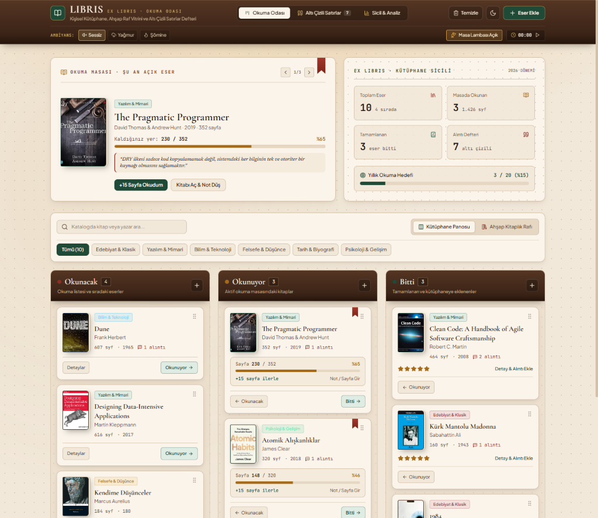
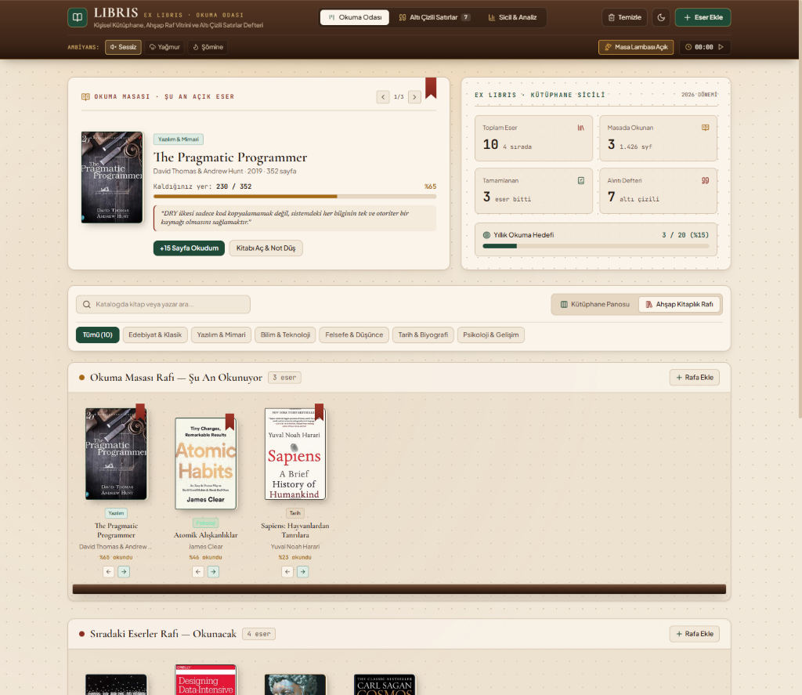
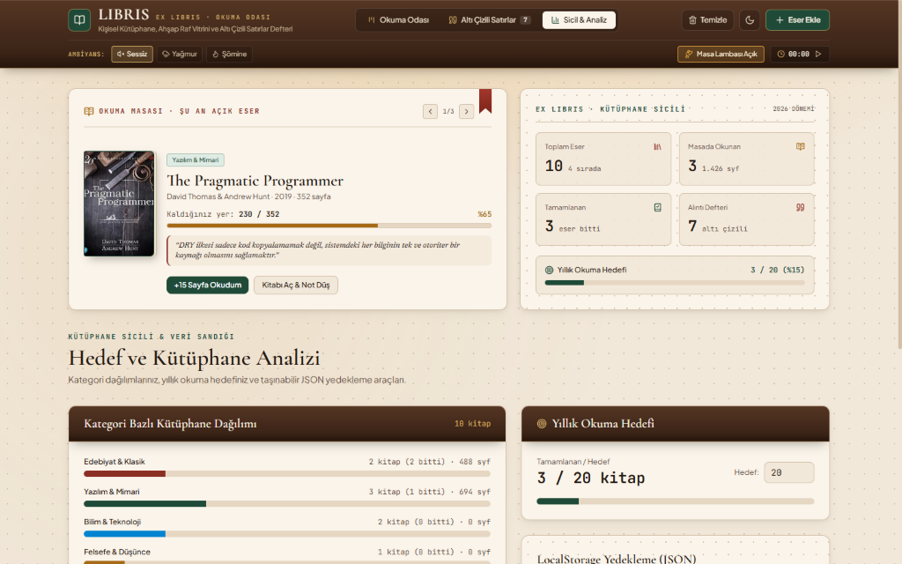

# LIBRIS // Kişisel Kütüphane ve Okuma Panosu

- **Canlı Uygulama (Netlify):** https://libris-kutuphane.netlify.app
- **GitHub Deposu:** https://github.com/sefakesen/libris-book-kanban

**Web Geliştirme; Yapay Zeka Proje Yönergesi** kapsamında geliştirilmiş; **"Okunacak", "Okunuyor" ve "Bitti"** üç sütunlu Kanban panosu, canlı **Open Library API** kitap arama entegrasyonu, **LocalStorage** kalıcılığı, sayfa ilerleme takibi ve kitaba özel alıntı/not defteri sunan modern bir web uygulamasıdır.

---

## Yönerge Uyumluluk Özeti (Adım 1–7)

| Yönerge Adımı | Uygulanan Çözüm |
| --- | --- |
| **1. Teknoloji Seçimi** | React 19 (Vite 6), LocalStorage kalıcılığı, Open Library API, Netlify yayını |
| **2. Yapay Zeka Aracı** | Antigravity AI asistanı ile planlama, kod üretimi, güvenlik denetimi ve doğrulama |
| **3. Kurulum ve Ortam** | Vite + Tailwind CSS v4, modüler `components/`, `hooks/`, `utils/` klasör yapısı |
| **4. Planlama** | `Book` ve `LibraryState` veri modeli, 3 sütunlu Kanban ve 3 ana görünüm sekmesi |
| **5. Geliştirme** | Custom hook (`useBooks.js`), drag & drop, canlı API arama ve hata ayıklama |
| **6. Fikir & Özellikler** | Okunacak/Okunuyor/Bitti Kanban, kapak alanı, yazar, renkli rozetler, durum butonları |
| **7. Dokümantasyon & Teslim** | Gerçek ekran görüntüleri (`screenshots/`), detaylı `README.md`, public GitHub + Netlify |

---

## Ekran Görüntüleri

### 1. Okuma Masası & Üç Sütunlu Ceviz Kanban Panosu


### 2. Ahşap Kitaplık Rafı (Vitrin Görünümü)


### 3. Sicil, Hedef ve Kütüphane Analizi


---

## Temel Özellikler

- **Klasik Okuma Odası (Dark Academia) Atmosferi:** Ceviz ahşap alınlık ve raf kirişleri, sıcak parşömen kağıdı, 3B ciltli ve sayfa kalınlıklı kitap kapakları (`.book-3d`), kurdele ayraçlar ve "Masa Lambası" ışıklandırma desteği.
- **Okuma Masası Vitrini & 3 Sütunlu Kanban + Ahşap Raf Modu:** Üstte aktif okunan kitabın açık durduğu *Okuma Masası* ve *Ex Libris Kütüphane Sicili*; altta hem sürükle-bırak destekli 3 sütunlu Kanban (`Okunacak`, `Okunuyor`, `Bitti`) hem de tek tıkla geçilebilen yatay **Ahşap Kitaplık Rafı** görünümü yer alır.
- **Yağmur / Şömine Ambiyansı & Okuma Seansı Sayacı (`utils/ambienceAudio.js`):** Harici ses dosyasına ihtiyaç duymadan tarayıcı Web Audio API ile sakin yağmur ve şömine sesi üreten ambiyans kontrolleri ile okuma seansı kronometresi.
- **İki Sayfalı "Açık Kitap" Detay Defteri (`BookDetailModal.jsx`):** Sol sayfada kitap künyesi, durum geçişleri, yıldız puanı ve sayfa ilerleme kaydırıcısı; sağ sayfada çizgili defter üzerinde sayfa numaralı alıntı ve kenar notu ekleme alanı.
- **Canlı Open Library API Entegrasyonu (`utils/api.js`):** Yeni eser eklerken `https://openlibrary.org/search.json` üzerinden gerçek kitap adı, yazar, yayın yılı, sayfa sayısı ve kitap kapağı otomatik doldurulabilir; kapaksız kitaplar için pirinç çerçeveli 3B tipografik cilt üretilir.
- **LocalStorage Kalıcılığı ve JSON Yedekleme (`utils/storage.js`):** Veriler tarayıcıda kalıcı olarak saklanır, JSON olarak dışa aktarılabilir ve güvenli şema doğrulamasıyla içe aktarılabilir.
- **Gündüz ("Sıcak Parşömen") ve Gece ("Masa Lambası & Maun") Teması:** CSS değişkenleri tabanlı çift tema desteği.

---

## Kullanılan Teknolojiler

- **React 19 (JavaScript / JSX)** — Bileşen tabanlı kullanıcı arayüzü
- **Vite 6** — Hızlı geliştirme sunucusu ve üretim paketleyicisi
- **Tailwind CSS v4 (`@tailwindcss/vite`)** — Modern, duyarlı stil ve tema sistemi
- **Lucide React** — İnce çizgili ikon seti
- **Open Library Search API** — Uzak kitap kataloğu ve kapak görseli kaynağı
- **LocalStorage & JSON Schema Validation** — İstemci taraflı kalıcı veri depolama
- **Netlify / Vercel** — SPA yönlendirme dosyaları (`netlify.toml`, `vercel.json`) ile üretime hazır dağıtım

---

## Proje Klasör Yapısı

```text
libris-book-kanban/
├── screenshots/
│   ├── bookshelf-view.png
│   ├── kanban-board.png
│   └── quotes-analytics.png
├── src/
│   ├── components/
│   │   ├── AnalyticsView.jsx     # Kategori analizi, yıllık hedef ve JSON yedekleme
│   │   ├── BookCard.jsx          # Katalog fişi kartı, 3B kapak, kurdele ayraç ve durum butonları
│   │   ├── BookCover.jsx         # 3B ciltli gerçek kapak + pirinç çerçeveli tipografik fallback
│   │   ├── BookDetailModal.jsx   # İki sayfalı Açık Kitap defteri (ilerleme + çizgili alıntılar)
│   │   ├── BookFormModal.jsx     # Open Library API arama + manuel eser kayıt fişi
│   │   ├── BookshelfView.jsx     # 3B ceviz ahşap raflar üzerinde kitaplık vitrini
│   │   ├── Header.jsx            # Ceviz alınlık, sekmeler, ambiyans sesi, masa lambası ve sayaç
│   │   ├── KanbanBoard.jsx       # Arama/filtreleme, görünüm geçişi ve 3 sütunlu Kanban
│   │   ├── QuotesView.jsx        # Çizgili okuma defterinde altı çizili satırlar akışı
│   │   └── SummaryCards.jsx      # Okuma Masası vitrini ve Ex Libris kütüphane sicili
│   ├── constants/
│   │   └── bookConstants.js      # Sütun ve kategori tanımları
│   ├── hooks/
│   │   └── useBooks.js           # Custom hook (tüm CRUD, ilerleme, alıntı ve tema state'i)
│   ├── utils/
│   │   ├── ambienceAudio.js      # Web Audio API tabanlı yağmur ve şömine ambiyans üreteci
│   │   ├── api.js                # Open Library API istemcisi (timeout ve sanitizasyon)
│   │   ├── seedData.js           # 9 kitaplık başlangıç kütüphanesi
│   │   └── storage.js            # LocalStorage, XSS/Prototype Pollution korumalı doğrulama
│   ├── App.jsx
│   ├── main.jsx
│   └── index.css
├── .gitignore
├── index.html
├── netlify.toml
├── vercel.json
├── vite.config.js
└── package.json
```

---

## Kurulum ve Yerel Çalıştırma

Ön gereksinim: **Node.js 18+** ve **npm**

```bash
# 1. Depoyu klonlayın ve klasöre girin
git clone https://github.com/sefakesen/libris-book-kanban.git
cd libris-book-kanban

# 2. Bağımlılıkları yükleyin
npm install

# 3. Geliştirme sunucusunu başlatın
npm run dev

# 4. Üretim derlemesi (Production Build) alın
npm run build
```

Uygulama varsayılan olarak `http://localhost:5173` adresinde açılır.

---

## Yapay Zeka Hangi Aşamalarda Nasıl Kullanıldı?

Bu proje, geliştirme yaşam döngüsünün her aşamasında yapay zeka asistanı (**Antigravity AI**) ile birlikte planlanıp doğrulanmıştır:

1. **Fikir ve Planlama Aşaması (Adım 4):**
   - Etkileşimli gereksinim analizi ile 3 sütunlu Kanban kurgusu, Open Library API entegrasyonu, alıntı defteri ve veri modeli (`Book` ve `LibraryState`) tasarlandı.
   - Kullanılan örnek planlama istemi: *"Okunacak, Okunuyor ve Bitti başlıklı üç sütunlu bir kitap okuma Kanban panosu tasarla. Kartlarda kapak alanı, yazar adı, renkli kategori rozeti ve durum değiştirme butonları olsun; kitaplar Open Library API'den aranabilsin ve LocalStorage'da saklansın."*
2. **Bileşen Geliştirme ve Stil Tasarımı (Adım 5 & 6):**
   - `useBooks.js` custom hook yapısı, `BookCard.jsx`, `BookFormModal.jsx` ve CSS değişkenleriyle Açık/Koyu tema paleti yapay zeka desteğiyle modüler olarak üretildi.
3. **Güvenlik Denetimi ve Hata Ayıklama (Debugging):**
   - JSON yedek içe aktarımında Prototype Pollution (`__proto__`) koruması, kapak URL'leri için `http/https` protokol doğrulaması ve dış kapak görselleri yavaş yüklendiğinde boş kutu kalmasını engelleyen `BookCover.jsx` katmanlı fallback düzeltmesi yapay zeka eşliğinde test edilip uygulandı.
4. **Dokümantasyon ve Teslim (Adım 7):**
   - Tarayıcı testlerinden elde edilen ekran görüntüleri `screenshots/` klasörüne eklendi ve bu `README.md` dokümanı oluşturuldu.

---

## GitHub'a Yükleme ve Canlı Yayına Alma

### GitHub'a Yükleme
```bash
git init
git add .
git commit -m "feat: LIBRIS kitap okuma kanban uygulamasi"
git branch -M main
git remote add origin https://github.com/sefakesen/libris-book-kanban.git
git push -u origin main
```

### Netlify veya Vercel ile Yayınlama
- **Netlify:** [app.netlify.com](https://app.netlify.com) üzerinden *"Add new site > Import an existing project"* seçin ve GitHub deponuzu bağlayın. `netlify.toml` dosyası `npm run build` komutunu ve `dist` yayın klasörünü otomatik olarak algılar.
- **Vercel:** [vercel.com](https://vercel.com) üzerinden *"Add New Project"* ile deponuzu bağlayın; Vite ayarları ve `vercel.json` yönlendirme kuralları otomatik uygulanır.
